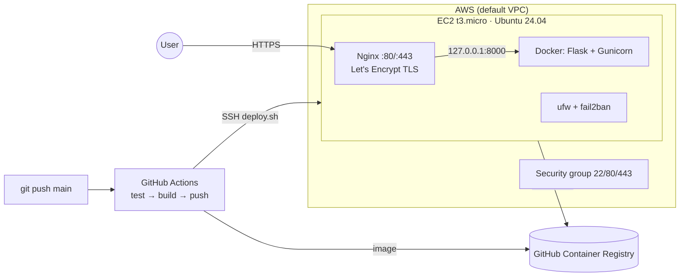

# Automated Cloud Deployment (AWS EC2 + Nginx + HTTPS)


An end-to-end, scripted path from an empty AWS account to a containerised app served over HTTPS. Every push to `main` then redeploys it automatically.

> Portfolio project. The provisioning script is **dry-run by default** and only creates AWS resources when you set `CONFIRM=yes`. No live instance is attached to this repo, so the deploy job skips itself until `EC2_HOST` is configured.

## Architecture



## What it automates

| Step | How |
|---|---|
| **Provision the VM** | `infra/launch-ec2.sh` uses the AWS CLI. It looks up the latest Ubuntu AMI from SSM, creates a security group (22/80/443), launches an IMDSv2-only instance and passes in cloud-init. |
| **Bootstrap the server** | `infra/cloud-init.yaml` installs Docker, Nginx and Certbot, sets up the ufw firewall and fail2ban, and creates a `deploy` user with an SSH key. |
| **Reverse proxy** | `nginx/app.conf.template` forwards headers, adds security headers and keeps upstream connections alive. The app only listens on `127.0.0.1`. |
| **SSL** | `scripts/setup-nginx-ssl.sh` runs Certbot with HTTP→HTTPS redirect and turns on automatic renewal. |
| **Continuous deployment** | The GitHub Actions workflow runs the tests, ShellCheck, a cloud-init check and `nginx -t`. It then builds the image, pushes it to GHCR and deploys over SSH. |
| **Safe rollout** | `scripts/deploy.sh` health-checks the new container and restores the previous image if the check fails. |
| **Cleanup** | `infra/teardown-ec2.sh` removes the instance and security group. |

## Step by step

1. **Provision** (with AWS CLI credentials configured):
   ```bash
   export AWS_REGION=eu-central-1 KEY_NAME=my-key DEPLOY_PUBLIC_KEY="$(cat ~/.ssh/ci_deploy.pub)"
   ./infra/launch-ec2.sh             # dry run, shows the plan
   CONFIRM=yes ./infra/launch-ec2.sh # creates the instance
   ```
2. **DNS:** point an A record for your domain at the instance's public IP.
3. **HTTPS** (on the server):
   ```bash
   git clone https://github.com/AmanMasood/automated-cloud-deployment.git && cd automated-cloud-deployment
   sudo DOMAIN=app.example.com EMAIL=you@example.com ./scripts/setup-nginx-ssl.sh
   echo "APP_ENV=production" | sudo tee /opt/app/app.env
   ```
4. **CI/CD:** add the repo secrets `EC2_HOST` and `EC2_SSH_KEY` (the deploy private key), and a `DOMAIN` variable. Every push to `main` now deploys.
5. **Tear down** when you're finished: `./infra/teardown-ec2.sh`.

## Security choices

- The app container binds to localhost only, so it's reachable only through Nginx.
- Inbound traffic is limited to 22/80/443. `SSH_CIDR` lets you restrict SSH to your own IP.
- IMDSv2 is required on the instance, which blocks SSRF-style metadata theft.
- The deploy user has no general sudo, only permission to reload Nginx.
- No secrets are kept in the repo. Everything comes from GitHub secrets or `/opt/app/app.env` on the host.

## Run the app locally

```bash
pip install -r app/requirements.txt pytest && pytest -q
docker build -t cloud-deploy-demo . && docker run -p 8000:8000 cloud-deploy-demo
```

## Tech stack

AWS EC2 · AWS CLI · cloud-init · Ubuntu · Docker · Nginx · Let's Encrypt / Certbot · ufw · fail2ban · GitHub Actions · GHCR · Bash · Python/Flask

## License

MIT
